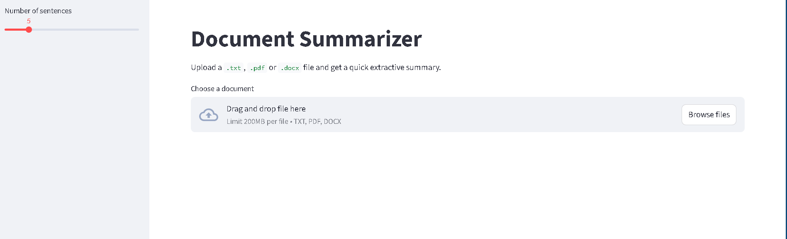

# Document Summarizer

A lightweight Streamlit application for generating quick extractive summaries from uploaded documents. The app extracts text from supported file formats, processes it with NLTK, and returns a concise summary based on sentence importance.

[](https://document-summary3.streamlit.app/)

## Usage

The screenshot below shows the Document Summarizer interface and the typical workflow:



### How to Use

1. **Launch the application** using the command in the [Run the Application](#run-the-application) section.
2. **Upload a document** in `.txt`, `.pdf`, or `.docx` format.
3. **Adjust the summary length** using the **Number of sentences** slider in the sidebar (3–15 sentences).
4. **Review the extracted content** in the document preview panel.
5. **Read the generated summary**, along with the original and summary word counts.

## Features

- **Simple document upload** — Upload supported documents directly from the browser.
- **Extractive summarization** — Generates a summary by selecting the most relevant sentences from the source text.
- **Configurable summary length** — Choose how many sentences to include in the summary.
- **Document preview** — Inspect the first portion of extracted text before reviewing the summary.
- **Word count comparison** — Compare the original document length with the generated summary.

## Supported File Types

| Format | Extension | Notes |
|--------|-----------|-------|
| Plain Text | `.txt` | Text is read directly from the file. |
| PDF | `.pdf` | Text extraction works for text-based PDFs. Scanned/image-only PDFs require OCR. |
| Word Document | `.docx` | Text is extracted from document paragraphs. |

## Getting Started

### Prerequisites

- Python 3.9+ recommended
- `pip` for installing dependencies

### Installation

1. Clone the repository:

   ```bash
   git clone <repository-url>
   cd Document-Summariser-main
   ```

2. Create and activate a virtual environment (recommended):

   ```bash
   python -m venv .venv
   ```

   **Windows (PowerShell):**

   ```powershell
   .venv\Scripts\Activate.ps1
   ```

   **macOS/Linux:**

   ```bash
   source .venv/bin/activate
   ```

3. Install dependencies:

   ```bash
   pip install -r requirements.txt
   ```

## Run the Application

Start the Streamlit app with:

```bash
streamlit run app.py
```

After running the command, open the local URL displayed in your terminal (typically `http://localhost:8501`).

## How It Works

1. The app accepts an uploaded `.txt`, `.pdf`, or `.docx` file.
2. Text is extracted from the document using the appropriate reader.
3. NLTK tokenizes the text and removes common stopwords.
4. Sentences are scored based on word frequency.
5. The highest-scoring sentences are selected to create an extractive summary.

## Notes

- The summarizer is **extractive**, meaning it selects existing sentences rather than generating new text.
- Image-only or scanned PDFs may not produce usable text without OCR.
- Required NLTK resources (`punkt_tab` and `stopwords`) are downloaded automatically on first run.

## Dependencies

The project uses the following main packages:

- [Streamlit](https://streamlit.io/) — Web application interface
- [NLTK](https://www.nltk.org/) — Text tokenization and stopword processing
- [pypdf](https://pypdf.readthedocs.io/) — PDF text extraction
- [python-docx](https://python-docx.readthedocs.io/) — DOCX text extraction
- [PyMuPDF](https://pymupdf.readthedocs.io/) — Additional PDF processing support
